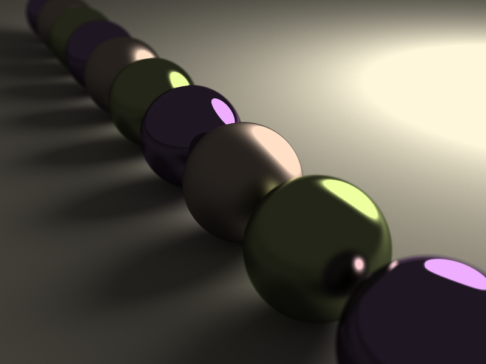

`demo2.yml`, 1479.900397s, 44 cores, 16384 samples per pixel:



Building
========

```
$ cargo build
```

Running
=======

For a fast low-quality render:

```
$ cargo run --bin flux -- -r 32 -R 10 -g scenes/demo2.yml
```

For a slower but very high-quality render:

```
$ cargo run --bin flux -- -r 150 -d 16 -R 5 -g scenes/demo2.yml
```

While the graphical preview is being updated, `Esc` will cancel the
rendering at any time.
